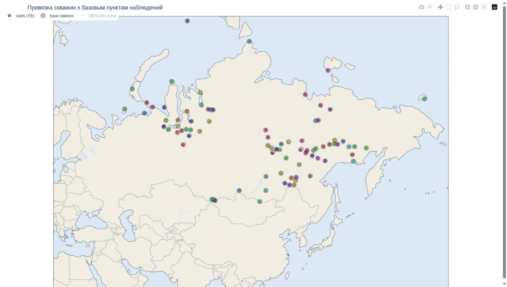
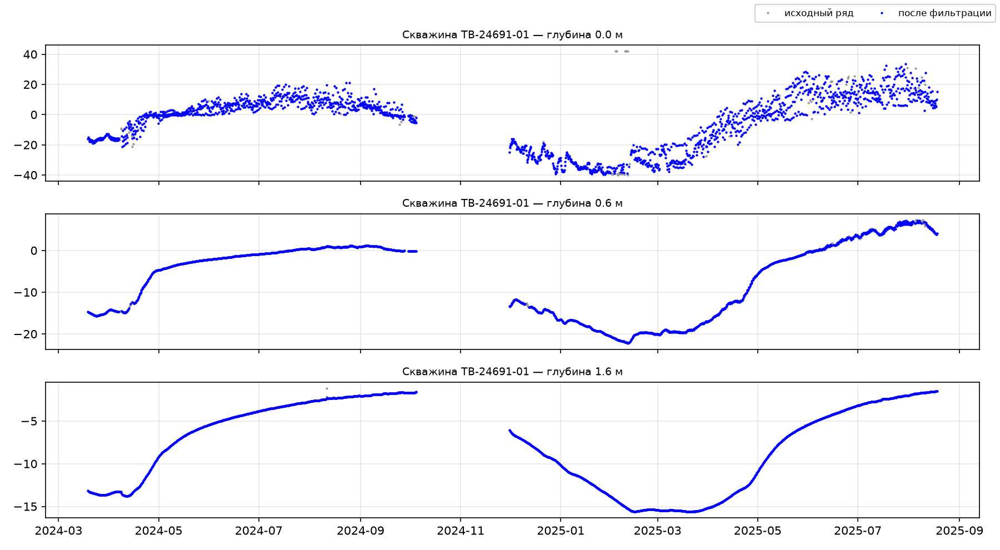

# permaflow

От телеметрии сети мониторинга многолетней мерзлоты к готовому
продукту для научной работы. Работа построена в **два этапа**; на первом
можно остановиться и получить регулярные ряды скважин, второй очищает их от
технических артефактов.

> EN: From raw permafrost monitoring telemetry to a research-ready product —
> two-stage preprocessing: ST-DBSCAN clustering with regularisation, then
> robust outlier filtering with gap recovery.

Проект создан на основе материалов магистерской диссертации
[«Оценка влияния изменений климата на состояние многолетней мерзлоты с учётом
новых источников информации»](http://elib.rshu.ru/files_books/pdf/rid_ac7306d822f94751979087debbfc173b.pdf) (РГГМУ, 2025).

---

## Модель сети

* **cluster** — непрерывный период сообщений одного устройства (IMEI) в одном
  месте: ST-DBSCAN (Birant & Kut, 2007) с пространственным радиусом по классу
  точности координат (GNSS ~60 м; LBS/вышки ~19 км) и временным радиусом
  (30 суток — разрывает периоды после долгих перерывов передачи).
* **БПН** — базовый пункт наблюдений из реестра `base_stations.csv`
  (5-значный код ВМО, название, координаты, часовой пояс). Кластер
  привязывается к ближайшему БПН.
* **скважина (TB)** — кластеры одного БПН, лежащие в окрестностях eps **друг
  друга** (каждый кластер хранит свой eps по классу точности; односторонняя
  близость — разные скважины). Идентификатор: `TB-<код БПН>-<NN>`.



90 скважин на 84 БПН, точки окрашены по своему БПН; крупные маркеры с
чёрным контуром — сами БПН. Шум ST-DBSCAN по умолчанию скрыт: в
интерактивной версии
[`site_map_interactive.html`](docs/examples/site_map_interactive.html)
он включается кликом по записи в легенде, при наведении показываются
число измерений скважины и расстояние до БПН.

## Схема пайплайна

```
этап 1 (--stage cluster)
data/raw/AllData.csv ──► зона интереса + ручные исключения
        ▼
ST-DBSCAN по устройствам ──► привязка к БПН ──► сборка скважин TB-*
        ▼
RES_clustered.csv  (well id × DateTime × cluster × GNSS × T1..T32)
        ▼
регуляризация: единая сетка времени 6h, отбраковка прогрева прибора
        ▼
data/intermediate/RES_regularized.csv  (well id × Date × Time × GNSS × глубины 0–25 м)
+ wells_summary.csv, wells.csv, clusters.csv, figures/site_map_interactive.html
        │            ← на этом можно остановиться
        ▼
этап 2 (--stage filter)
фильтрация выбросов: порог по уровню + пороги Лапласа по вейвлет-невязке,
выравнивание ступеней смены прибора, восстановление пропусков по глубинам
(12 ч где жив суточный ход … 30 суток на сезон-свободных горизонтах)
        ▼
data/intermediate/RES_clean.csv + removal_rates.csv + figures/series_*.png
```

Работа фильтра на скважине М-2 Делянкир (TB-24691-01): серые точки —
исходный ряд с телеметрическими сбоями до ±41 °C на 0.0 м, синие — после
фильтрации (сезонный ход и аномалии не сглаживаются, удаляются только
артефакты):



**Интерактивная карта привязки** (`site_map_interactive.html`, plotly):
точки БПН крупнее, насыщеннее и с чёрным контуром; при наведении — число
измерений скважины и расстояние до БПН, для кластеров без привязки —
ближайший БПН и расстояние до него.

## Быстрый старт

```bash
pip install -e ".[dev]"
python -m permaflow --config configs/permaflow.yaml                # оба этапа
python -m permaflow --config configs/permaflow.yaml --stage cluster  # только этап 1
python -m permaflow --config configs/permaflow.yaml --stage filter   # только этап 2
pytest
```

Этап 2 читает `output_dir/RES_clustered.csv` (свой путь — ключ
`filter_input`), поэтому его можно перезапускать независимо от этапа 1.

Прогон на реальной выгрузке (~140 тыс. сообщений, 112 устройств, 3 года)
даёт 90 скважин на 84 БПН.

## Структура репозитория

```
├── configs/permaflow.yaml     # пути, параметры обоих этапов
├── src/permaflow/
│   ├── data_io.py             # AllData, base_stations.csv, devices.csv
│   ├── geo.py                 # haversine, зона интереса
│   ├── clustering.py          # ST-DBSCAN, привязка к БПН, сборка скважин
│   ├── prepare.py             # регуляризация: единая сетка, карта глубин
│   ├── outliers.py            # фильтры выбросов, выравнивание ступеней
│   ├── reporting.py           # интерактивная карта привязки
│   ├── pipeline.py            # два этапа + CLI (python -m permaflow)
│   └── config.py              # YAML-конфигурация
├── tests/                     # pytest: ST-DBSCAN, скважины, контракт продукта, фильтры
├── docs/methodology.md        # описание методик
│   └── examples/              # примеры артефактов: карта (статичная и интерактивная), «до/после» фильтрации
└── data/                      # raw/ — исходные данные
```

## Входные данные (data/raw/)

| файл | содержимое |
|------|------------|
| `AllData.csv` | сырые сообщения устройств: `M_ID`/`IMEI`, `DateTime`, GNSS-координаты, `T1..T32` — температуры датчиков 0–25 м |
| `base_stations.csv` | БПН: 5-значный код ВМО, название (английская транслитерация), координаты (5 знаков), часовой пояс |
| `devices.csv` | устройства: ID, погрешность координат (м) — задаёт класс точности, MinPts |

Глубины датчиков `T1..T32` соответствуют 0.0–25.0 м (карта — в
`permaflow.prepare.DEPTH_MAP`).

## Ключевые решения

- **ST-DBSCAN, а не K-means** — число скважин неизвестно заранее, а «шум»
  (тестовые стенды, перевозка) должен явно помечаться; временной радиус
  разрывает периоды одного прибора после долгих перерывов передачи.
- **Раздельная кластеризация GNSS/LBS** — часть устройств не имеет GNSS и
  позиционируется по вышкам связи (заявленная погрешность ~85 км против ~30 м
  у GNSS). Один радиус DBSCAN на оба класса разрушает либо GNSS-пункты
  (слипаются через LBS-облако), либо сами LBS-ряды (всё уходит в шум).
- **Привязка к БПН по строкам термоскважин** — по задумке алгоритма
  у пункта может быть несколько скважин с собственными координатами
  в реестре.
- **Скважины по правилу взаимной близости** — кластеры одного БПН сливаются,
  только если лежат в окрестностях eps друг друга; односторонняя близость —
  разные скважины (АМС Актру: GNSS-кластер с eps 60 м и LBS-облако с
  eps 19 км — разные скважины).
- **Фильтрация без сглаживания аномалий** — помеченные выбросы удаляются
  целиком; серийные сбои (насыщение датчика, «залипший» канал) ловит
  отдельный порог по уровню, поскольку вейвлет-детренд поглощает их в
  аппроксимацию. Восстановление пропусков дозировано по изменчивости
  ряда: 12 ч там, где жив суточный ход (линейно), 10 суток в зоне
  годового хода (Akima), 30 суток на сезон-свободных глубинах (мост по
  средним у границ пропуска); длинные потери связи остаются NaN.
- **Ступени смены прибора — только по доказуемому** — выравниваются лишь
  ступени на границах кластеров, подтверждённые на сезон-свободных
  горизонтах (≥ 12 м); естественный сезонный ход через пропуски связи
  неотличим от приборной ступени и не «исправляется».

## Лицензия

MIT — см. [LICENSE](LICENSE).
